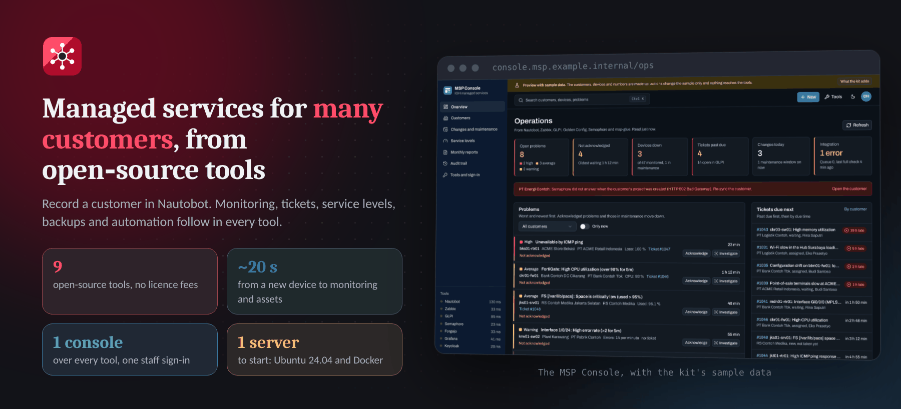
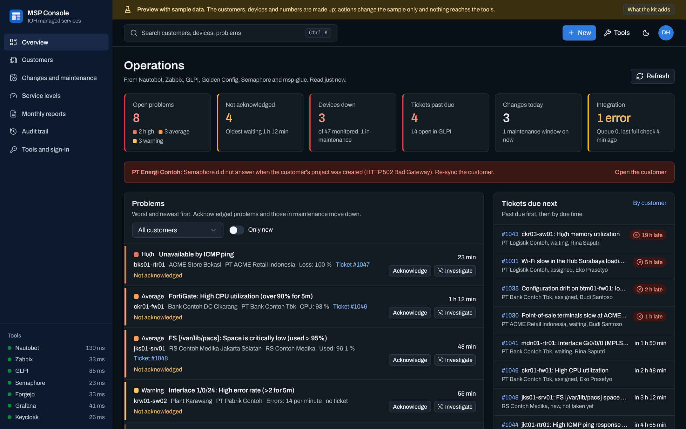
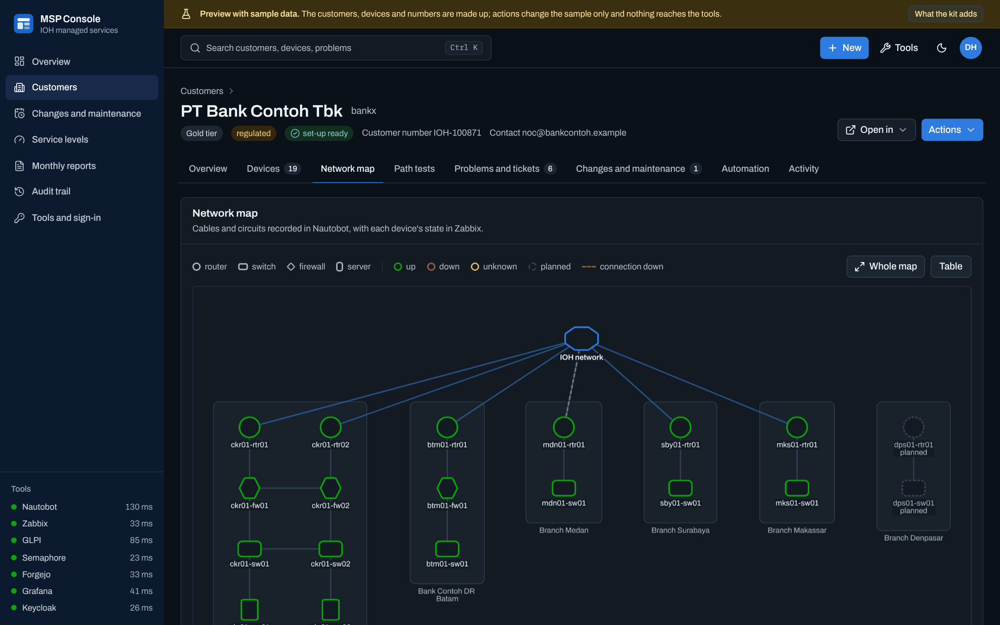
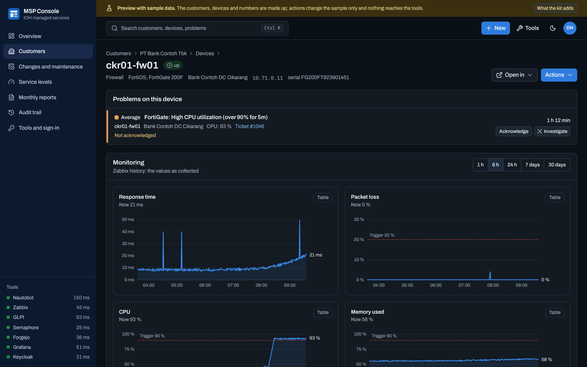
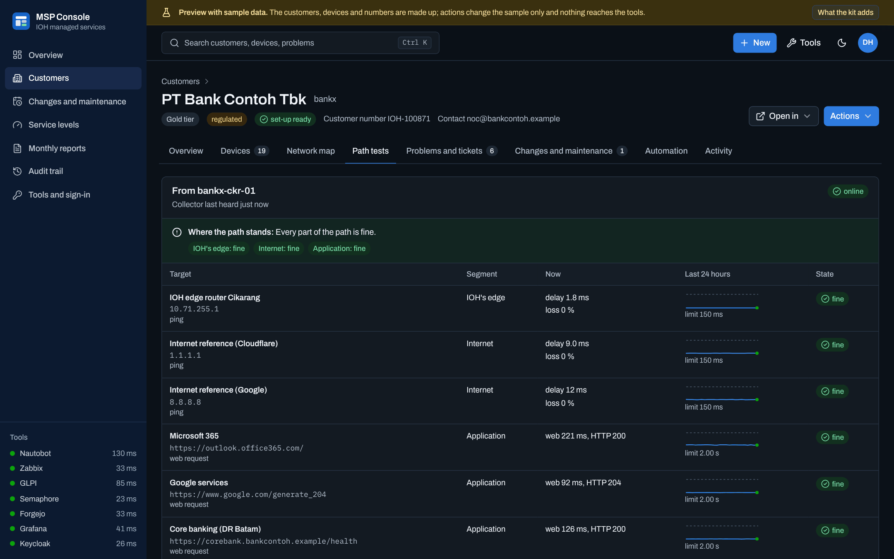
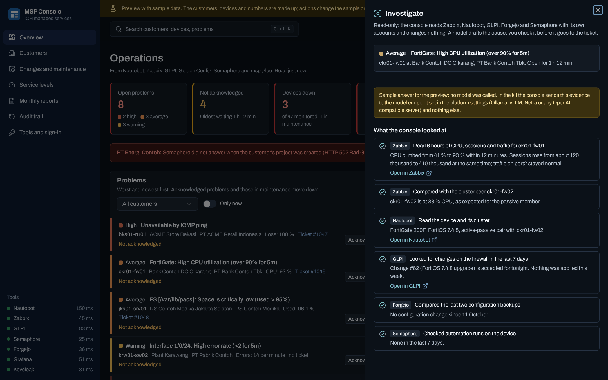
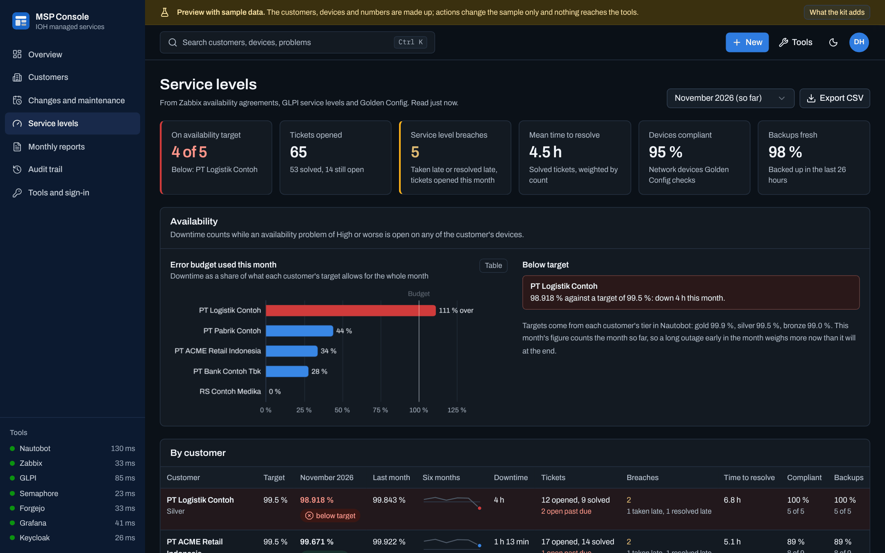
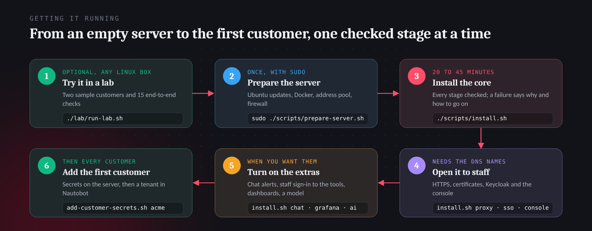

<p align="center">
  
</p>

<h1 align="center">IOH MSP Stack</h1>

<p align="center">
  <em>Record a customer once in Nautobot, and every tool of the managed services platform follows.</em>
</p>

<p align="center">
  
  
  
  
  
  
  
  <br>
  <a href="https://github.com/adamnugraha/ioh-msp-stack/actions/workflows/images.yml"></a>
  <a href="https://github.com/adamnugraha/ioh-msp-stack/actions/workflows/zabbix-templates.yml"></a>
</p>

<p align="center">
  
</p>

<p align="center">
  <a href="#what-it-is">What it is</a> &middot;
  <a href="#how-it-works">How it works</a> &middot;
  <a href="#the-msp-console">The console</a> &middot;
  <a href="#try-it-in-a-lab">Try it</a> &middot;
  <a href="#install-on-a-server">Install</a> &middot;
  <a href="#use-it-every-day">Use</a> &middot;
  <a href="#extend-it">Extend</a> &middot;
  <a href="#explore-the-code">Explore</a>
</p>

---

## What it is

IOH runs infrastructure and networks for many customers at once: banks, hospitals, retailers, factories. Each
customer needs monitoring, a service desk with its own service levels, configuration backups, automation and a
monthly report, and none of them may ever see another customer's data.

This kit builds that platform on one server from open-source tools only, and adds the small piece that ties them
together. An engineer creates the customer and its devices in Nautobot; the kit's integration service, msp-glue,
creates everything else in every tool and keeps it right. The MSP Console then shows what every tool knows on one
set of pages, behind one staff sign-in.

| Role | Tool | Licence |
|---|---|---|
| Network source of truth, configuration backup and compliance | Nautobot 3.2 with Golden Config 3.0 | Apache 2.0 |
| Monitoring, alerting and monthly availability per customer | Zabbix 7.0 LTS | AGPL 3.0 |
| Service desk, customer portal, service levels, asset register | GLPI 11 | GPL 3.0 |
| Automation (Ansible and OpenTofu runs) | Semaphore UI Community 2.19 | MIT |
| Git server for backups, templates and playbooks | Forgejo 12 | GPL 3.0 or later |
| Customer dashboards (phase 3) | Grafana OSS 13 with the Zabbix plugin | AGPL 3.0 / Apache 2.0 |
| Single sign-on for staff | Keycloak 26 | Apache 2.0 |
| Chat alerts to Telegram, Microsoft Teams or e-mail | Versus Incident 1.4 | MIT |
| Language model on the server for report text and Investigate (optional) | Ollama 0.40 with an open-weight model (Qwen3 8B by default) | MIT, Apache 2.0 |
| **Integration service and the MSP Console** | **msp-glue (this kit)** | IOH-owned code |

Tested versions are pinned in `.env.example` and the compose files: Nautobot 3.2.6, Golden Config 3.0.8, Zabbix
7.0.31, GLPI 11.0.11, Semaphore 2.19.14, Forgejo 12.0.4, Grafana 13.2.3 with Zabbix plugin 6.8.0, Keycloak 26.8.0,
Versus Incident 1.4.13. The Python packages of msp-glue are pinned in `glue/constraints.txt`.

## How it works

<p align="center">
  
</p>

Three ideas carry the whole design:

- **Nautobot is the record.** Customers are Nautobot tenants in the group "Managed Services Customers"; their
  devices, sites, cables and circuits live there too. No other tool is edited by hand for a customer's set-up.
- **msp-glue keeps everything else in step.** It reacts to Nautobot's and GLPI's webhooks within seconds, and every
  10 minutes it runs a repair pass over every customer. Every step is safe to run again, so a tool that was down
  simply catches up.
- **Each customer is fenced off in every tool.** Its own GLPI entity, Zabbix host groups and read-only group,
  Semaphore project, backup repository and Grafana organisation. A customer's Grafana data source can read only
  that customer's hosts, even if someone edits a dashboard query.

<p align="center">
  
</p>

When something breaks, the tools pass the problem along in order, and the customer's GLPI ticket collects every
step:

<p align="center">
  
</p>

Configuration drift found by Golden Config opens its own GLPI tickets, and a link forecast to reach 80 % of its
commit rate within 45 days opens a capacity ticket.

## The MSP Console

`https://console.<domain>` shows every tool on one set of pages. Staff sign in once through Keycloak; every action
checks the person's role and is written to the console's audit trail before it runs. The pictures below are the
console's own preview, with the kit's made-up sample data.

<table>
  <tr>
    <td width="50%"></td>
    <td width="50%"></td>
  </tr>
  <tr>
    <td><b>Operations.</b> Open problems of every customer, worst first, with their tickets; tickets due next; devices down; today's changes; msp-glue's job queue.</td>
    <td><b>Customer pages.</b> Devices, a network map from Nautobot's cables and circuits, problems and tickets, changes, automation runs and the customer's audit trail.</td>
  </tr>
  <tr>
    <td></td>
    <td></td>
  </tr>
  <tr>
    <td><b>Device pages.</b> Zabbix charts from an hour to 30 days, interfaces with their cables and circuits, configuration backups and Golden Config's results with secrets masked.</td>
    <td><b>Path tests.</b> From each site collector to IOH's edge, the internet and the customer's applications, with a verdict on which side a slowdown is.</td>
  </tr>
  <tr>
    <td></td>
    <td></td>
  </tr>
  <tr>
    <td><b>Investigate.</b> The console reads the tools with its own accounts and a model you run drafts the cause; the engineer checks it before it goes to the ticket.</td>
    <td><b>Service levels.</b> Availability against target, breaches, time to resolve, compliance and backups for this month or the two before, with a CSV export.</td>
  </tr>
</table>

The console also drafts each customer's **monthly report** on the first night of the month, in Bahasa Indonesia or
English; an engineer or manager corrects and approves it before it goes out, and every number the data does not
contain is flagged.

To click through the preview yourself:

```bash
docker run -d -p 8080:8080 adityanugraha/ioh-msp-stack:console-preview    # then open http://localhost:8080
```

## Try it in a lab

You need a Linux machine or VM with Docker (Compose 2.20 or later), 4 vCPU, 8 GB RAM, 40 GB disk, and Internet
access for the first build.

```bash
git clone https://github.com/adamnugraha/ioh-msp-stack && cd ioh-msp-stack
./lab/run-lab.sh                       # builds, starts, adds two sample customers, runs 15 end-to-end checks
python3 lab/check.py golden_config     # run one check again (the names are the functions in lab/check.py)
```

The lab uses simulated Cisco routers and a Linux server with a Zabbix agent, so every path runs for real: a device
in Nautobot becomes a Zabbix host and a GLPI asset, an outage opens a ticket, a drifted router gets a drift ticket.
Behind a TLS-inspecting proxy, export `HTTPS_PROXY` and `LAB_CA_FILE=/path/to/proxy-ca.crt` first.

## Install on a server

<p align="center">
  
</p>

The platform runs on one Ubuntu 24.04 server: in IOH's private cloud, on Google Cloud, on AWS or on a VPS. Get the
kit on the server, either as the checked zip of a release or with `git clone`:

```bash
curl -fL -o /tmp/ioh-msp-stack.zip https://raw.githubusercontent.com/adamnugraha/ioh-msp-stack/main/dist/ioh-msp-stack-v1.6.0.zip
sha256sum /tmp/ioh-msp-stack.zip      # must equal the line for this file in dist/SHA256SUMS
sudo mkdir -p /opt/ioh-msp-stack && sudo chown "$(id -un):" /opt/ioh-msp-stack
rm -rf /tmp/kit && mkdir /tmp/kit && unzip -q /tmp/ioh-msp-stack.zip -d /tmp/kit
cp -a /tmp/kit/*/. /opt/ioh-msp-stack/ && chmod +x /opt/ioh-msp-stack/scripts/*.sh
```

Then, from `/opt/ioh-msp-stack`, with one account for every step (only the first command needs sudo):

```bash
sudo ./scripts/prepare-server.sh --admin-networks "10.10.0.0/16 10.20.0.0/16" --pool 172.31.0.0/16 --tz Asia/Jakarta
# log out and in again, so your account's docker group applies

./scripts/install.sh preflight                     # check the server; changes nothing
./scripts/install.sh settings --domain msp.ioh.internal --subnet 172.30.0.0/24 \
    --admin-networks "10.10.0.0/16 10.20.0.0/16" --tz Asia/Jakarta --email noc@example.co.id
./scripts/install.sh                               # every remaining core stage, in order
./scripts/install.sh proxy                         # HTTPS on https://<tool>.<domain>
./scripts/install.sh sso --admin-email you@ioh.co.id --name "Your Name"
./scripts/install.sh console                       # the MSP Console
./scripts/install.sh status                        # which stages are done
```

When a stage fails, the installer stops with the reason, the fix and the command that continues after the fix.
Every password the platform uses is generated into `.env`; customer secrets live in `secrets/`, never in Git.

| Read next | For |
|---|---|
| [docs/install.md](docs/install.md) | Every stage and setting: certificates, staff sign-in to the tools, the sign-in gate, chat alerts, Grafana, the language model, sample customers, images from Docker Hub |
| [environments/](environments/README.md) | Google Cloud, AWS, a VPS and IOH's private cloud; a Cloudflare Tunnel or direct access; the automatic install with one settings file |
| [docs/upgrading.md](docs/upgrading.md) | Moving from one kit version to the next |

### Your first customer

```bash
./scripts/add-customer-secrets.sh acme     # device log-in and SNMP secrets, typed hidden, stored in secrets/tenants/acme/
```

Then in Nautobot, create a tenant in the group "Managed Services Customers" with the custom field `msp_code` set to
`acme`, and add its devices. msp-glue picks the tenant up from Nautobot's webhook at once, or at the next
repair run at the latest; `docker compose exec msp-glue mspctl tenant list` shows its state.

## Use it every day

| To | Run |
|---|---|
| Check that msp-glue reaches every tool | `docker compose exec msp-glue mspctl check` |
| See every customer and its provisioning state | `docker compose exec msp-glue mspctl tenant list` |
| Provision or repair one customer now | `docker compose exec msp-glue mspctl tenant sync acme` |
| See what a device sync would change, without changing it | `docker compose exec msp-glue mspctl --dry-run device sync acme` |
| Register a collector at a customer site | `docker compose exec msp-glue mspctl proxy add acme proxy-acme-01` |
| Give a customer user its GLPI portal and Grafana | `docker compose exec msp-glue mspctl user add acme budi@acme.example --name "Budi Santoso" --grafana` |
| Add a staff member | `docker compose exec msp-glue mspctl staff add eko@ioh.co.id --name "Eko Prasetyo" --role engineer` |
| Send a test message to the NOC chat | `docker compose exec msp-glue mspctl chat test` |
| Back up everything (nightly, from cron, as root) | `sudo ./scripts/backup.sh` |

Staff roles in Keycloak decide what each person may do:

| Role | In the console |
|---|---|
| `manager` | Reads everything; drafts and approves monthly reports |
| `engineer` | Also acknowledges problems, opens tickets and changes, plans maintenance, adds devices, re-syncs customers |
| `automation` | Also starts playbooks, always for an open ticket or an approved change of the same customer |

A disabled account or a removed role takes effect in the console within five minutes. Every command, with its
details, is in [docs/operations.md](docs/operations.md).

## Extend it

Most behaviour is set in one file, [`glue/mappings.yaml`](glue/mappings.yaml), and in two Git repositories in
Forgejo that every customer shares. Code changes are needed only for a new kind of action or a new tool.

| You want to | Change | Guide |
|---|---|---|
| Add a playbook | the `msp/playbooks` repository, then `semaphore.templates` | [A new playbook](docs/extending.md#a-new-playbook) |
| Run a playbook when a change is approved | `automation.change_templates` | [When a change is approved](docs/extending.md#a-playbook-that-runs-when-a-change-is-approved) |
| Monitor a new kind of device | `zabbix.platforms` | [New device kind](docs/extending.md#monitoring-for-a-new-kind-of-device) |
| Back up and check a new platform's configuration | `golden_config.platforms` and a Jinja template | [Golden Config](docs/extending.md#configuration-backups-and-compliance-for-a-new-platform) |
| Change service tiers, targets, chat or ticket rules | `glpi`, `zabbix.sla`, `chat` | [Tiers and rules](docs/extending.md#service-tiers-targets-and-ticket-rules) |
| Watch a customer site the platform cannot reach | an edge collector | [edge-collector/](edge-collector/README.md) |
| Add a console page or action | `types.ts`, `api.py`, a page | [The console](docs/extending.md#a-new-page-or-action-in-the-msp-console) |
| Add a whole new tool | a compose file, a Caddy block, a client | [A new tool](docs/extending.md#a-new-tool) |

## Explore the code

| Start here | To understand |
|---|---|
| [`glue/msp_glue/server.py`](glue/msp_glue/server.py) | The webhooks, the job queue and the 10-minute repair run |
| [`glue/msp_glue/tenants.py`](glue/msp_glue/tenants.py) | How one Nautobot tenant becomes a customer in every tool |
| [`glue/msp_glue/devices.py`](glue/msp_glue/devices.py) | How a device becomes a Zabbix host and a GLPI asset |
| [`glue/msp_glue/changes.py`](glue/msp_glue/changes.py) | An approved GLPI change starting a playbook |
| [`glue/msp_glue/console/actions.py`](glue/msp_glue/console/actions.py) | Every console action, its role check and its audit entry |
| [`glue/console-ui/src/lib/api/types.ts`](glue/console-ui/src/lib/api/types.ts) | The contract between the console's pages and its service |
| [`glue/mappings.yaml`](glue/mappings.yaml) | Every rule the platform follows, in one file |
| [`scripts/install.sh`](scripts/install.sh) | The installer and its stages |

```text
compose.yaml          single-host deployment; includes one compose file per tool from components/
.env.example          every setting and secret; copy it with scripts/gen-env.sh
components/           one folder per tool, so tools can be split across VMs later
glue/                 msp-glue and the MSP Console: Python package, Dockerfile, mappings.yaml, tests
glue/console-ui/      the console's pages (React, TypeScript, shadcn/ui) and their preview with sample data
edge-collector/       the Zabbix proxy for a customer site
golden-config/        starter content of the shared Golden Config repository
semaphore/playbooks/  starter content of the shared playbook repository
zabbix/               webhooks to GLPI and the chat, and the path test templates
grafana/              the customer dashboard template
scripts/              prepare-server.sh, install.sh, autoinstall.sh, backup.sh and helpers
environments/         Google Cloud, AWS, a VPS, IOH's private cloud, and the two ways in from outside
lab/                  simulated devices, sample customers, run-lab.sh and the end-to-end checks
docs/                 the guides linked from this page, and the figures
```

Run the unit tests (no tools needed) and the console preview:

```bash
cd glue && pip install -c constraints.txt -e '.[test]' && python -m pytest -q
cd glue/console-ui && npm ci && npm run dev:demo      # the preview at http://localhost:5173
```

Every push builds both images, scans them with Trivy and pushes them from `main`
([images.yml](.github/workflows/images.yml)); the path test templates are tested against a real Zabbix 7.0
([zabbix-templates.yml](.github/workflows/zabbix-templates.yml)).

## More

- [Known issues found during testing](docs/known-issues.md): 23 behaviours of the tools that the kit works around,
  or that you need to know about when you run it.
- [Upgrading](docs/upgrading.md) from any earlier kit version.
- The full guide, "IOH open-source managed services platform", and the interactive install guide "IOH MSP Platform
  Install" come with the kit.
